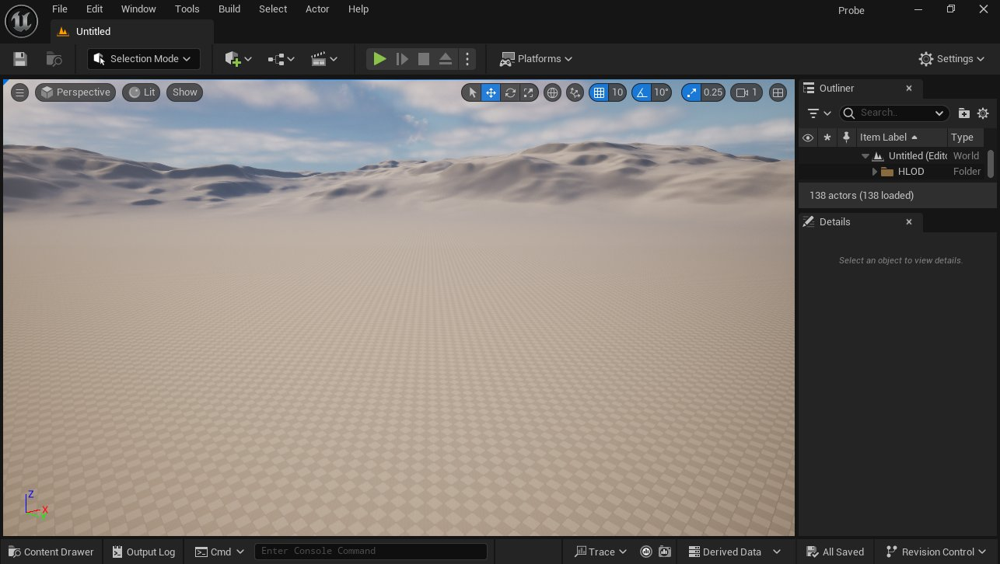

# Unreal Engine 5.4 editor on the DGX Spark (GB10, aarch64 Linux)

Epic ships no Unreal Editor for Linux on ARM64. This repository builds the UE 5.4 editor natively on an NVIDIA
DGX Spark, makes the third-party libraries reproducible, and documents what actually renders on the GB10.

It builds on the port patch from [MrQbit/unreal-dgx](https://github.com/MrQbit/unreal-dgx) (build-tool and
platform changes). What this repository adds:

- **Scripts that rebuild every third-party library** the editor needs on aarch64 (about 25), one step per library,
  re-runnable, with downloads pinned by hash or commit — `scripts/thirdparty/`.
- **A placeholder generator that does not break the process** — `tools/make_stub.py`. The approach of exporting
  every symbol of an x86 library as `return 0` also exports C++ runtime symbols some of those libraries carry,
  which crashes unrelated libraries (Embree, in our case).
- **Four engine changes** found while getting the viewport, Lumen, Nanite and `-game` to work, including a fix for
  Nanite meshes that never stream in beyond their coarsest level — `docs/GB10_RENDERING.md`.
- **Tools to run and inspect the real editor from SSH**: Xvfb + the NVIDIA Vulkan driver, screenshots, and driving
  the editor through Remote Control — `tools/`, `examples/`.

## Status (checked 2026-11-16 on one DGX Spark, driver 580.159.03, Ubuntu 24.04.4)

| | |
|---|---|
| Editor window and viewport on the GB10 (Vulkan SM5 and SM6) | works |
| Lumen (software tracing) | works |
| Nanite | works after the streaming fix |
| `-game` window from the editor binary | works after two small fixes |
| 1080p frame rate, simple scenes | 85–128 fps (`docs/GB10_RENDERING.md`) |
| FBX, Bink encoding, Steam, EOS, OpenXR, OpenCV, PROJ, libvpx | **placeholders — do not work** |
| Cook / packaging, Play-in-Editor, hardware ray tracing, real content | not tested |



Details, numbers, screenshots and known problems: [docs/GB10_RENDERING.md](docs/GB10_RENDERING.md).
How each library is handled: [docs/THIRD_PARTY.md](docs/THIRD_PARTY.md).

## Build

Needs: an aarch64 Ubuntu 24.04 machine (tested: DGX Spark), access to Epic's GitHub (link your Epic account),
about 140 GB of disk, and roughly an hour of build time on top of the downloads (~20 GB).

### 1. Toolchain

```bash
sudo apt-get install -y clang-18 clang-tools-18 libc++-18-dev libc++abi-18-dev lld-18 build-essential \
    cmake ninja-build python3 libfontconfig-dev libfreeimage-dev libsndfile1 libxml2-dev vulkan-tools \
    xvfb x11-apps python3-pil
# UnrealBuildTool looks for unversioned tool names: put links in a folder on PATH
mkdir -p ~/llvm18-bin
for t in clang clang++ ld.lld lld llvm-ar llvm-ranlib llvm-nm llvm-objcopy llvm-strip; do ln -sf /usr/bin/$t-18 ~/llvm18-bin/$t; done
# arm64 .NET: SDK 8 plus the 6.0 runtimes UnrealBuildTool's tools target
curl -fsSL https://dot.net/v1/dotnet-install.sh -o dotnet-install.sh
bash dotnet-install.sh --channel 8.0 --arch arm64 --install-dir ~/.dotnet
bash dotnet-install.sh --channel 6.0 --runtime dotnet     --arch arm64 --install-dir ~/.dotnet
bash dotnet-install.sh --channel 6.0 --runtime aspnetcore --arch arm64 --install-dir ~/.dotnet
export DOTNET_ROOT=$HOME/.dotnet PATH=$HOME/llvm18-bin:$HOME/.dotnet:$PATH
```

### 2. Engine source and the port patch

```bash
git clone --branch 5.4 https://github.com/EpicGames/UnrealEngine.git ~/UnrealEngine
cd ~/UnrealEngine && git checkout 847de5e2553adeb4d3498953604d0b0abe669780

git clone https://github.com/MrQbit/unreal-dgx.git ~/unreal-dgx
git -C ~/unreal-dgx checkout c5e8a776c3fe6a5bc0585c223be4c2ad4d732154
echo "eae0c885ad6c41d8bf941b4f21e66dce786d323c0e833ce5beb41f3d3b513506  $HOME/unreal-dgx/patches/unreal-engine-5.4-aarch64.patch" | sha256sum -c
git apply ~/unreal-dgx/patches/unreal-engine-5.4-aarch64.patch
```

Then make the four small engine changes in [docs/GB10_RENDERING.md](docs/GB10_RENDERING.md#extra-engine-changes)
(Embree, Nanite streaming, `-game`, XMPP — the last one is done by a script in step 4).

### 3. Native GitDependencies, then the engine dependencies

```bash
dotnet publish Engine/Source/Programs/GitDependencies/GitDependencies.csproj -c Release -r linux-arm64 \
    --self-contained true -p:PublishTrimmed=false -o Engine/Binaries/DotNET/GitDependencies/linux-arm64
bash Engine/Build/BatchFiles/Linux/GitDependencies.sh --force      # ~19 GB download, ~80 GB unpacked
```

One licence PDF (Avid DNxHD) is refused by Epic's CDN with HTTP 403 and the tool exits with an error at the end;
nothing in the build needs that file.

### 4. Third-party libraries

```bash
UE_ROOT=~/UnrealEngine ~/ue5-dgx-spark/scripts/thirdparty/build_all.sh
```

About 20 minutes. Logs in `~/ue-arm64-thirdparty/logs`. Single steps can be re-run, e.g.
`scripts/thirdparty/build_intree.sh tbb png` or `scripts/thirdparty/build_downloaded.sh embree`.

### 5. Editor

```bash
cd ~/UnrealEngine
UE_ARM64_MINIMAL_EDITOR=1 ./Engine/Build/BatchFiles/Linux/Build.sh UnrealEditor Linux Development -ForceUseSystemCompiler
```

About 35 minutes on the Spark (3956 actions). Quick check without a window:
`./Engine/Binaries/Linux/UnrealEditor-Cmd -run=CompileAllBlueprints -unattended -nopause -nosplash -nullrhi`.

### 6. Run it with the real renderer

```bash
tools/run_editor_xvfb.sh /path/to/Project.uproject     # Xvfb :98 + NVIDIA Vulkan; first start ~4 min of shaders
python3 tools/xshot.py :98 editor.png                   # screenshot of the virtual screen
```

`examples/project/` is the small test project used for the results (Vulkan SM6, Lumen, Nanite, Remote Control on
127.0.0.1:30010). `examples/rc.py` calls the editor over Remote Control; `examples/make_lumen_room.py` and
`examples/make_nanite_grid.py` build the two test scenes through it.

## Licences

- The code in this repository is MIT licensed (`LICENSE`).
- No Unreal Engine source is included. The few lines of C++/C# shown in `docs/` are new code written for these
  changes. Unreal Engine itself is covered by Epic's EULA.
- The port patch is not included; it is fetched from its own repository in step 2.
- Libraries built by the scripts come from the engine tree or from their upstream projects (METIS, Draco, ispc,
  Embree) under their own licences.

## Limits of this work

Tested on one machine. The scripts were run end to end on an already prepared engine tree, not yet from a fresh
clone. Only simple test scenes were measured.
