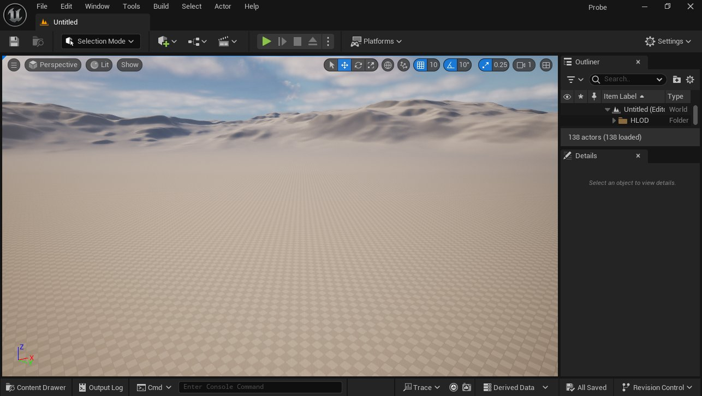
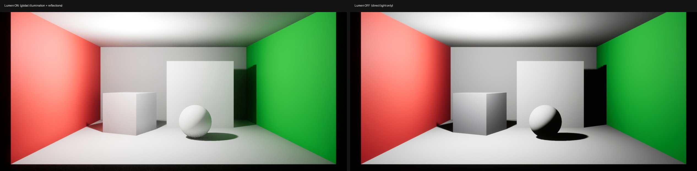
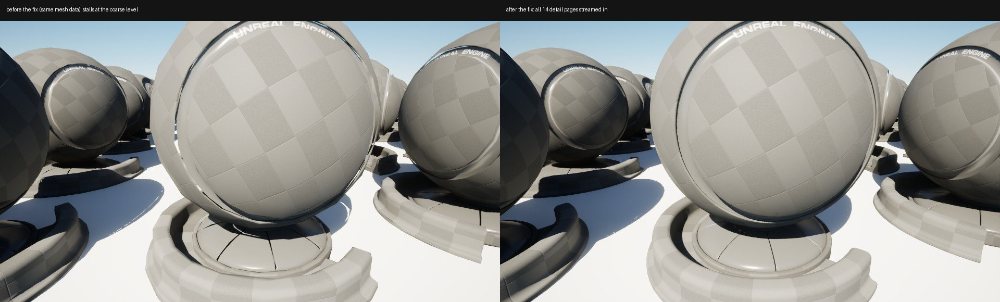

# Rendering on the GB10: what was checked, and the extra changes it needed

Checked on 2026-11-16 on a DGX Spark (GB10, NVIDIA driver 580.159.03, Ubuntu 24.04.4, clang 18.1.3), UE 5.4 at
`847de5e25` with the port patch (README step 2), the changes below, and the libraries from `scripts/thirdparty/`.
"Checked" below means seen on screen (screenshots) or measured; everything else is listed under *Not tested*.

## Results

| Item | Result |
|---|---|
| Editor window + viewport, Vulkan on the GB10 | **works** — `LogVulkanRHI: DeviceName: NVIDIA GB10`, API 1.4.312; first start ~4 min (shader compile) |
| Vulkan SM6 (project setting) | works; hardware ray tracing stays off (not tested) |
| Lumen (software tracing) | **works** — closed test room, same camera, fixed exposure: with Lumen the shadowed areas are lit by bounce light and the green wall bleeds onto the floor; without it they are black. Needs Embree (below). |
| Nanite | **works after one engine fix** (below); before it, some meshes stayed at their coarsest level forever |
| `-game` (standalone window from the editor binary) | works after two small fixes (below) |
| Blueprint compile commandlet | 0 errors |
| Remote Control HTTP API (driving the editor without a mouse) | works (`-RCWebControlEnable`, 127.0.0.1:30010) |







Frame times (Development editor binary, `-game`, 1920x1080, VSync off, read from `stat unit`; simple scenes, so
treat them as a first indication only):

| Scene | fps | GPU time | Note |
|---|---|---|---|
| Open World template map (Lumen, volumetric clouds) | 85.6 | 8.4 ms | 1 reading |
| 1600 copies of a 32k-vertex Nanite mesh + sun + sky light | 93–94 | 7.7–7.9 ms | 3 readings; camera spawned at floor level, half the screen below ground |
| Small Lumen test room | 123–128 | 4.6–4.8 ms | 3 readings; same camera problem |

Build: full editor build 3956 actions in 33 min on the 10 performance cores.

## Extra engine changes

Apply these by hand after the port patch. The code shown is new code written for these changes, not Epic's.

**1. Embree on arm64** (`Engine/Source/ThirdParty/Intel/Embree/Embree3.Build.cs`). Without Embree the editor
cannot build mesh cards or distance fields (100+ `Platform did not set USE_EMBREE, GenerateCardRepresentationData
failed` warnings) and Lumen loses most of its scene. Add a branch before the final `else`, pointing at the
library `scripts/thirdparty/build_downloaded.sh embree` builds:

```csharp
else if (Target.IsInPlatformGroup(UnrealPlatformGroup.Unix) && Target.Architecture == UnrealArch.Arm64)
{
    string Lib = Path.Combine(Target.UEThirdPartyBinariesDirectory, "Intel/Embree/Embree3135/Linux/aarch64-unknown-linux-gnueabi/lib");
    PublicSystemIncludePaths.Add(Path.Combine(Target.UEThirdPartySourceDirectory, "Intel/Embree/Embree3135/Linux/aarch64-unknown-linux-gnueabi/include"));
    PublicAdditionalLibraries.Add(Path.Combine(Lib, "libembree3.so"));
    RuntimeDependencies.Add(Path.Combine(Lib, "libembree3.so"));
    RuntimeDependencies.Add(Path.Combine(Lib, "libembree3.so.3"));
    PublicDefinitions.Add("USE_EMBREE=1");
}
```

**2. Nanite streaming stalls at the coarse level** (`Engine/Source/Runtime/Engine/Private/Rendering/NaniteStreamingManager.cpp`,
`ProcessNewResources`). Not arm64-specific: a 5.4 logic gap that Epic fixed on the builder side in 5.7
(`CalculateFinalPageHierarchyDepth` in `NaniteEncodeHierarchy.cpp`; 5.4–5.6 have it). On PC the node culling runs
one pass per hierarchy level, and the number of passes comes from the deepest level among *installed* pages. If
the leaves that request a page sit deeper than every installed page (seen: root → node 11 → node 19 holds the
leaves for page 2, while the root page and page 1 only reach depth 1), they are never visited, the page is never
requested, and the mesh stays coarse forever — no error anywhere. Whether a mesh is affected depends on its
hierarchy layout, which differed from build to build here (same mesh and settings: 61–66 leaves over 13 builds).
Fix on the runtime side (also works for data that is already built): when a resource's root page is registered,
count the deepest level of the whole resource instead of only the root page's. Replace the two lines that set
`RootPageInfo.MaxHierarchyDepth` from the root page and add it to `HierarchyDepthManager` with:

```cpp
uint8 ResourceMaxDepth = PageStreamingState.MaxHierarchyDepth;
for (const FPageStreamingState& AnyPage : Resources->PageStreamingStates)
{
    ResourceMaxDepth = FMath::Max(ResourceMaxDepth, AnyPage.MaxHierarchyDepth);
}
RootPageInfo.MaxHierarchyDepth = ResourceMaxDepth;
HierarchyDepthManager.Add(ResourceMaxDepth);
```

Cost: a few extra, mostly empty node-culling passes per view. Checked: saved mesh data that stalled in 8 of 8
runs installed all 14 streaming pages in 5 of 5 runs after the fix.

**3. `-game` asserts in `CompileGlobalShaderMap` ("No target platforms found")**. Two causes:
- `Engine/Config/LinuxArm64/DataDrivenPlatformInfo.ini` needs the same host keys the port patch adds to the Linux
  one: `LinuxArm64:bIsEnabled=true` and `LinuxArm64:bUsesHostCompiler=true`.
- `Engine/Source/Developer/TargetPlatform/Private/TargetPlatformManagerModule.cpp`: in `-game`, only the platform
  named `IniPlatformName()` is initialised — `LinuxArm64` on this host — but the running platform of an editor
  binary (`LinuxEditor`) lives in the `Linux` module. Also let `Linux` through on an arm64 Linux host:

```cpp
bool bIsHostEditorPlatform = false;
#if PLATFORM_LINUX && PLATFORM_CPU_ARM_FAMILY
bIsHostEditorPlatform = (PlatformName == FName(TEXT("Linux")));
#endif
// ...and skip the platform only if (PlatformName != IniPlatformName() && !bIsHostEditorPlatform)
```

**4. XMPP link error `undefined symbol: __res_query`** (glibc ≥ 2.34). The `-lresolv` the port patch adds is not
enough here; `scripts/thirdparty/build_intree.sh strophe` adds a one-function forwarder to Epic's arm64
`libstrophe_fPIC.a`.

**5. Project settings used for SM6 / Lumen / Nanite** (`Config/DefaultEngine.ini` of the test project):

```ini
[/Script/LinuxTargetPlatform.LinuxTargetSettings]
-TargetedRHIs=SF_VULKAN_SM5
+TargetedRHIs=SF_VULKAN_SM6

[/Script/Engine.RendererSettings]
r.DynamicGlobalIlluminationMethod=1
r.ReflectionMethod=1
r.GenerateMeshDistanceFields=True
r.Shadow.Virtual.Enable=1
r.Nanite.ProjectEnabled=True
```

## Placeholders must not export runtime symbols

Exporting *every* defined symbol of an x86 library as a `return 0` function (as the port's original stub script
does) also exports the C/C++ runtime pieces some of them carry — `libfbxsdk.so` alone has ~430, e.g.
`std::__cxx11::basic_string::_M_create`. Once such a placeholder is loaded it interposes those symbols for the
whole process. Seen here: the arm64 `libembree3.so` crashed in its static initialisers as soon as the editor
loaded it, while it loaded fine in a small test program. `tools/make_stub.py` leaves out every name the system
runtime libraries export, the `std::` / `operator new/delete` / ABI families, and file-local symbols.
`scripts/thirdparty/make_placeholders.sh` regenerates all placeholders with it.

## Known problems

- **Render-graph crashes while a Nanite mesh was stalled**: garbage buffer pointer in
  `FRDGBuilder::ProcessAsyncSetupQueue`, once `check(StateBefore)` in `CollectPassBarriers` — 4 of 4 runs with the
  default parallel render-graph setup on the stalling data, 0 of 5 after the Nanite fix, 0 in all runs with
  `-dpcvars=r.RDG.ParallelSetup=0,r.RDG.ParallelExecute=0`. Why a stalled streamer leads there is not understood.
- One crash inside the NVIDIA driver in `vkCreateGraphicsPipelines` (PSO precompile thread) right after start-up;
  not seen again in ~20 starts.
- Virtual shadow map pages cached while a Nanite mesh is still coarse are not refreshed when the detail arrives
  (5.4 has no stream-in invalidation): dark patches with polygon edges. Rare once streaming works;
  `r.Shadow.Virtual.Cache 0` removes them.
- Oodle Texture does not load (`liboo2texlinux64.*.so` — x86 names); other texture encoders are used.
- Bink audio *encoding* is a stub: sounds that would cook to Bink fail to cook (8 warnings on the default map).
- No arm64 Python SDK: editor Python scripting is unavailable.

## Not tested

Cook / packaging, Play-in-Editor, hardware ray tracing, real production content, frame pacing (1 % lows),
long sessions, other GB10 / DGX driver versions.
