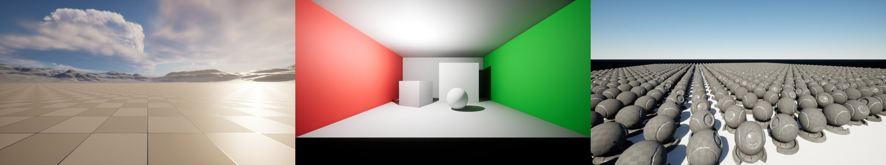
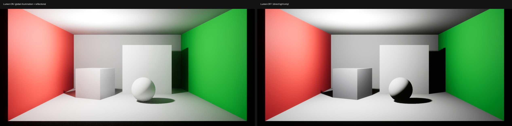
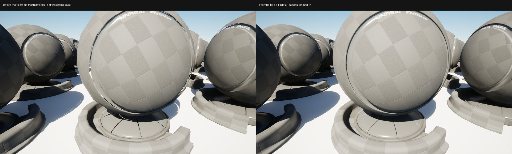
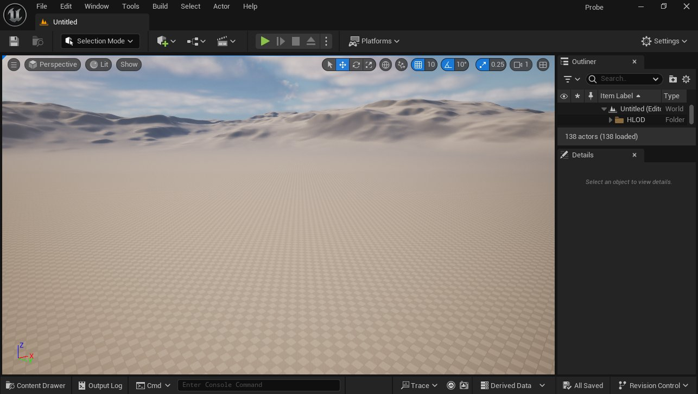

# Results on the GB10

Machine: DGX Spark (NVIDIA GB10), NVIDIA driver 580.159.03, Ubuntu 24.04.4 LTS, clang 18.1.3.
Engine: UE 5.4 at `847de5e2553adeb4d3498953604d0b0abe669780`, MrQbit's port patch, `scripts/apply_engine_changes.py`,
libraries from `scripts/thirdparty/`. Date: 2026-11-16.

## Frame times

`tools/bench_game.sh`: Development editor binary in `-game` mode, 1920×1080 window on Xvfb, VSync off, no frame
cap, 40 s warm-up, then 60 s recorded with the engine's FPS chart. Camera at a fixed PlayerStart.

| Scene | Average fps | GPU | Render thread | Game thread | 60 fps syncs missed | 120 fps syncs missed | Hitches |
|---|---|---|---|---|---|---|---|
| Open World template map | 86.4 | 8.35 ms | 3.89 ms | 1.19 ms | 0.00 % | 27.96 % | 0 |
| Lumen test room | 118.7 | 5.25 ms | 2.77 ms | 1.10 ms | 0.00 % | 1.07 % | 0 |
| Nanite grid, 1600 × 32k-vertex mesh | 80.3 | 9.20 ms | 5.10 ms | 1.23 ms | 0.00 % | 33.12 % | 0 |

Reproducibility check: after rebuilding both test scenes from `examples/` and measuring again, the room gave
118.71 fps (GPU 5.26 ms) and the Nanite grid 80.29 fps (GPU 9.19 ms).

Build times on the Spark: third-party libraries 4 min (`scripts/thirdparty/build_all.sh`), editor 33 min
(3956 actions). The first editor start compiles shaders for about 4 minutes; later starts log `Engine is initialized` about 7 seconds after the first log line.

## Lumen

A closed room with one point light and no sky, same camera, fixed exposure. With Lumen the areas the light does
not reach are lit by bounce light and the green wall tints the floor; without it they are black. A patch of the
back wall behind the partition reads RGB (8, 22, 8) with Lumen and (2, 2, 2) without. Lumen needs Embree to build
mesh cards and distance fields (`build_downloaded.sh embree` and the Embree change in `ENGINE_CHANGES.md`).

## Nanite

Without the streaming change, some Nanite meshes stay at their coarsest level indefinitely (faceted silhouettes,
cracks between clusters). With it, all 14 streaming pages of the test mesh load within seconds. Saved mesh data
that stalled in 8 of 8 runs before the change loaded fully in 5 of 5 runs after it. Cause and change:
[ENGINE_CHANGES.md](ENGINE_CHANGES.md#2-nanite-streaming-depth).

## Editor

The log reports `DeviceName: NVIDIA GB10`, Vulkan API 1.4.312. `UnrealEditor-Cmd -run=CompileAllBlueprints`
finishes with 0 errors. The Remote Control HTTP API (`-RCWebControlEnable`, port 30010) works in the editor and in
`-game`, which the example scripts and `tools/bench_game.sh` use.

## Known problems

- **Render-graph crash while Nanite streaming was stalled.** Before the streaming change, 4 of 4 runs on the
  stalling mesh data crashed: a garbage buffer pointer in `FRDGBuilder::ProcessAsyncSetupQueue`, once
  `check(StateBefore)` in `CollectPassBarriers`. After the change: 0 of 5. Turning the parallel render-graph setup
  off (`-dpcvars=r.RDG.ParallelSetup=0,r.RDG.ParallelExecute=0`) also prevented it. Why a stalled streamer leads
  to this crash is not understood.
- **One NVIDIA driver crash** in `vkCreateGraphicsPipelines` on the PSO precompile thread right after start-up. It
  did not recur in the 26 starts that followed.
- **Stale shadows.** Virtual shadow map pages cached while a Nanite mesh is still coarse are not refreshed when
  detail arrives (UE 5.4 has no invalidation for that), which shows as dark patches with polygon edges. With the
  streaming change, detail arrives within seconds and none were visible in the close-up test views. `r.Shadow.Virtual.Cache 0`
  removes them.
- **Oodle Texture** does not load (the build rules name the x86 library files); other texture encoders are used.
- **Bink audio encoding** is a placeholder, so sounds set to cook as Bink fail to cook (8 warnings on the default map).
- **No Python** in the editor: there is no aarch64 build of Epic's Python SDK.

## Not tested

Cooking and packaging, Play-in-Editor, hardware ray tracing, production content, long sessions, other driver
versions, and a build from a fresh clone.
